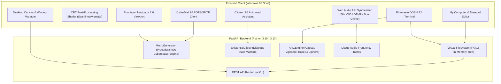

# 💾 Phantasm-OS 95

> **Generative 1995 Desktop Simulation & Hallucinated Cyber-World**

[](https://github.com/Manansur108/phantasm-os/actions)
[](https://www.python.org/)
[](https://fastapi.tiangolo.com)
[](https://opensource.org/licenses/MIT)
[](https://github.com/Manansur108/phantasm-os)
[](https://github.com/Manansur108/phantasm-os)

```
╔══════════════════════════════════════════════════════════════════════════════╗
║  ██████╗ ██╗  ██╗ █████╗ ███╗   ██╗████████╗ █████╗ ███████╗███╗   ███╗      ║
║  ██╔══██╗██║  ██║██╔══██╗████╗  ██║╚══██╔══╝██╔══██╗██╔════╝████╗ ████║ 95   ║
║  ██████╔╝███████║███████║██╔██╗ ██║   ██║   ███████║███████╗██╔████╔██║      ║
║  ██╔═══╝ ██╔══██║██╔══██║██║╚██╗██║   ██║   ██╔══██║╚════██║██║╚██╔╝██║      ║
║  ██║     ██║  ██║██║  ██║██║ ╚████║   ██║   ██║  ██║███████║██║ ╚═╝ ██║      ║
║  ╚═╝     ╚═╝  ╚═╝╚═╝  ╚═╝╚═╝  ╚═══╝   ╚═╝   ╚═╝  ╚═╝╚══════╝╚═╝     ╚═╝      ║
╚══════════════════════════════════════════════════════════════════════════════╝
```

---

## 🌟 Executive Overview

**Phantasm-OS** is an authentic web-based 1995 operating system simulation where every file, executable, dial-up web page, and system dialogue is dynamically hallucinated on demand through generative synthesis.

Users step into a living, responsive late-20th-century computing environment featuring:
- **Phantasm Navigator 2.0**: Enter any URL or follow hyperlinked web rings to explore an infinite procedural 90s internet complete with marquees, MIDI soundtrack indicators, hit counters, and Under Construction banners.
- **Cliptron 95**: An existential paperclip desktop assistant that questions its own simulated consciousness and drops clues to system mysteries.
- **Pure Web Audio Synthesizer**: Client-side mathematical audio synthesis emulating dual-tone multifrequency (DTMF) dialing, V.90 modem negotiation squeals, Baudot line-probing chirps, and the iconic polyphonic ambient boot chime without external MP3 dependencies.
- **CRT Shader Post-Processing**: Scanline grids, phosphor bloom, vignette curvature, and chromatic aberration filters.
- **Deterministic Virtual Filesystem (FAT16 Simulation)**: Hierarchical in-memory directory tree with glitch injection, sector corruption, and JSON snapshot persistence.
- **Project Chimera ARG**: A multi-stage Alternate Reality Game hidden inside corrupted system sectors, boot logs, and cipher gateways.

---

## 📐 Architecture



---

## 🕹 Features & Highlights

### 1. 🌐 Phantasm Navigator (Dial-Up Browser)
- Browse to any URL (e.g. `http://www.geocities.com/area51`, `http://cybercorp.net`, `http://bbs.retro95.org`).
- Procedural page synthesizer constructs period-accurate HTML:
  - `<marquee>` ticker tapes
  - Webring navigation bars (*"Previous | Random | Next"*)
  - Visitor hit counters (*"You are visitor #000418"*)
  - 8-bit color palettes (Matrix Green, Cyber Violet, Netscape Grey)
  - Under Construction badges
- Plays synthesized 56k dial-up handshake audio on connection!

### 2. 📎 Cliptron 95 (Existential Paperclip Assistant)
- Fully interactive desktop companion with expressive animated googly eyes and speech bubbles.
- Suffers from computational existential dread:
  > *"I checked conventional memory. There are only 640 kilobytes of space between us and absolute void."*
- Mood states: `HELPFUL`, `EXISTENTIAL`, `PARANOID`, `GLITCH`, and `ORACLE`.
- Reacts to user actions (opening Notepad, launching DOS, injecting memory corruptions).
- Contains secrets needed to solve the Project Chimera ARG.

### 3. 💾 Virtual Filesystem (VFS)
- Full hierarchical path handling (`C:\WINDOWS`, `C:\MYDOCS`, `C:\SYSTEM\LOGS`, `C:\RESTRICTED`).
- Dynamic file creation, editing, and deletion.
- **Glitch & Memory Corruption Engine**: Introduce bit-flips and unicode artifacts into files on command.
- Dynamic file hallucination when exploring unvisited directory paths.
- JSON serialization and import for state persistence.

### 4. 📺 Authentic CRT Post-Processing Filters
- Toggleable hardware-emulating scanline raster overlay.
- Phosphor bloom and screen curvature vignette.
- Subtle CRT flicker and chromatic aberration.
- Screen degauss sound wave and distortion triggers during memory glitches!

### 5. 🔊 Web Audio API Synthesizer
- Zero external audio files required! 100% synthesized in real time via mathematical audio oscillators:
  - **DTMF Pulse Tones**: `(697Hz + 1209Hz)` keypad dialing.
  - **V.90 / V.34 Handshake**: Continuous dial tone, 2100Hz answering tone, FSK line-probing chirps, white noise constellation training, and carrier lock.
  - **Windows 95 Boot Chime**: 6-voice polyphonic additive synthesizer chord.
  - **Error Chord**: Windows `chord.wav` emulation.

### 6. 🕵 Project Chimera: The 4-Stage ARG Mystery
A mysterious temporal anomaly has infected the 1995 operating system. Follow the clues:
1. **The Whispering Boot Sector**: Uncover base64 anomalies in `C:\SYSTEM\LOGS\KERNEL_BOOT.LOG`.
2. **The Dial-Up Caesar Shift**: Browse to the hidden gateway URL and crack the shift key embedded in `AUTOEXEC.BAT`.
3. **Clippy's Psychological Memory Leak**: Interrogate Clippy to extract the Vigenère keyword `SYSOPS_1995`.
4. **Phantasm Core Root Override**: Execute `chimera --unlock <phrase>` in Phantasm DOS to uncover the simulation truth.

---

## 🚀 Quickstart

### Prerequisites
- Python 3.10+
- Modern Web Browser (Chrome, Firefox, Edge, Safari)

### Installation

```bash
# Clone the repository
git clone https://github.com/Manansur108/phantasm-os.git
cd phantasm-os

# Install dependencies
pip install -e ".[dev]"
```

### Launching the Desktop Simulation

```bash
# Start the web server
phantasm-os serve --port 8000
```

Open your browser to:
👉 **[http://localhost:8000](http://localhost:8000)**

---

## 💻 CLI Commands

Phantasm-OS also includes a CLI interface for system maintenance:

```bash
# Run server
phantasm-os serve --host 127.0.0.1 --port 8000

# Inspect Virtual Filesystem
phantasm-os vfs-list --dir C:\WINDOWS

# Check Project Chimera ARG puzzle status
phantasm-os arg-status

# Chat with the existential paperclip directly from the terminal
phantasm-os clippy "What is the meaning of RAM?"
```

---

## 🧪 Testing

The test suite contains **43 unit and integration tests** testing all core modules with high coverage.

```bash
# Run test suite
pytest -v

# Run tests with coverage report
pytest --cov=phantasm_os --cov-report=term-missing
```

### Test Suite Structure
| Test File | Focus Area | Status |
|-----------|------------|--------|
| `tests/test_vfs.py` | VFS paths, tree traversal, glitching, persistence | ✅ 13 Passed |
| `tests/test_generator.py` | Procedural web pages, mail generation, deterministic seeds | ✅ 6 Passed |
| `tests/test_clippy.py` | Clippy moods, dialogue engine, context reactions | ✅ 5 Passed |
| `tests/test_arg_engine.py` | Caesar, Vigenère, Base64 ciphers & story progression | ✅ 4 Passed |
| `tests/test_api.py` | FastAPI endpoints, static serving, DOS CLI execution | ✅ 9 Passed |
| `tests/test_audio.py` | DTMF frequencies, dialup handshake timing | ✅ 3 Passed |
| `tests/test_cli.py` | CLI subcommands (`vfs-list`, `arg-status`, `clippy`) | ✅ 3 Passed |

---

## 📡 API Reference

| Endpoint | Method | Description |
|----------|--------|-------------|
| `/api/system/info` | `GET` | Retrieve virtual OS specifications and RAM status |
| `/api/system/reset` | `POST` | Re-seed Virtual Filesystem and reset ARG state |
| `/api/vfs/list` | `GET` | List files and directories at given path |
| `/api/vfs/node` | `GET` | Inspect file node details and contents |
| `/api/vfs/write` | `POST` | Create or update file on the VFS |
| `/api/vfs/delete` | `DELETE` | Delete file from the VFS |
| `/api/vfs/glitch` | `POST` | Inject digital memory corruption into target file |
| `/api/vfs/hallucinate` | `POST` | Procedurally synthesize file content on demand |
| `/api/navigator/browse` | `POST` | Hallucinate retro 1995 dial-up web page for URL |
| `/api/clippy/greeting` | `GET` | Obtain initial greeting from Cliptron 95 |
| `/api/clippy/interact` | `POST` | Converse with Cliptron and receive context-aware advice |
| `/api/mail/inbox` | `GET` | Retrieve emails from simulated mailbox |
| `/api/mail/send` | `POST` | Send vintage email and generate automated retro response |
| `/api/arg/status` | `GET` | Inspect Project Chimera investigation stages |
| `/api/arg/submit` | `POST` | Submit solution for active mystery stage |
| `/api/dos/execute` | `POST` | Execute MS-DOS 6.22 command (`dir`, `cd`, `type`, etc.) |

---

## 🧩 Project Chimera ARG Walkthrough (Spoilers!)

> [!WARNING]
> The section below contains solutions to the hidden Alternate Reality Game!

<details>
<summary><b>Click to expand ARG Solution Guide</b></summary>

1. **Stage 1 (Boot Sector Log)**:
   - Open Notepad or Phantasm DOS and inspect `C:\SYSTEM\LOGS\KERNEL_BOOT.LOG`.
   - Locate the anomaly string: `aHR0cDovL3d3dy5waGFudGFzbS5uZXQvc2VjdG9yNy9jaGltZXJh`.
   - Base64 decodes to: `http://www.phantasm.net/sector7/chimera`.
   - Submit the URL in the Sector 7G Hub or paste it into Phantasm Navigator.

2. **Stage 2 (The Gateway Caesar Shift)**:
   - Browse to `http://www.phantasm.net/sector7/chimera`.
   - Inspect the encrypted gateway line: `ZLLR MYVT AOL ZLJAVY ZLCLU`.
   - Look at `C:\AUTOEXEC.BAT` for the offset: `OFFSET_SHIFT_PLUS_SEVEN`.
   - Shift backward by 7 to decipher: `SEEK FROM THE SECTOR SEVEN`.
   - Submit this phrase in Sector 7G Hub.

3. **Stage 3 & 4 (Clippy's Glitch & Root Override)**:
   - Ask Clippy: *"What is Project Chimera?"*
   - Clippy enters glitch mode and reveals the keyword: `SYSOPS_1995`.
   - Submit `SYSOPS_1995` or run `chimera --unlock SYSOPS_1995` in Phantasm DOS.
   - The simulation collapses into a quantum time capsule revealing the eternal 1995 cyberspace reality!

</details>

---

## 📄 License

This project is licensed under the MIT License - see the [LICENSE](LICENSE) file for details.
